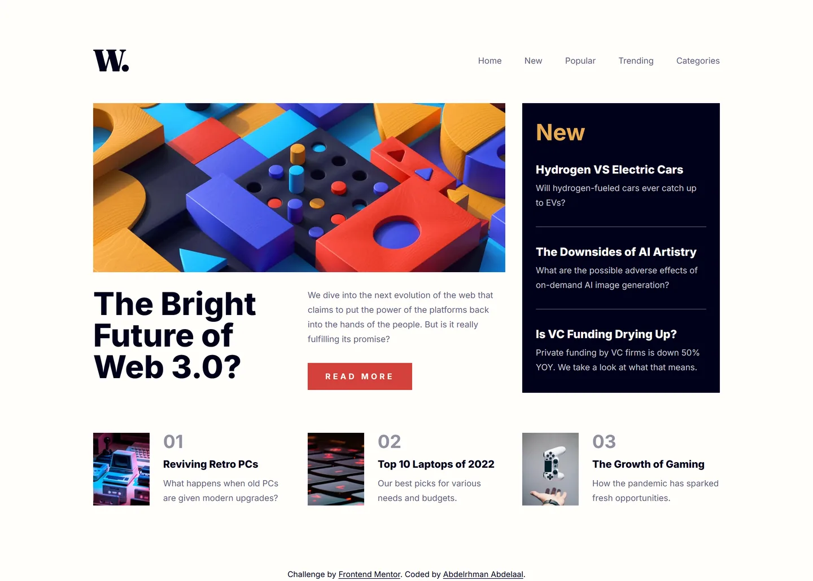

# Frontend Mentor - News homepage solution

This is a solution to the [News homepage challenge on Frontend Mentor](https://www.frontendmentor.io/challenges/news-homepage-H6SWTa1MFl). Frontend Mentor challenges help you improve your coding skills by building realistic projects.

## Table of contents

- [Overview](#overview)
  - [Screenshot](#screenshot)
  - [Links](#links)
- [My process](#my-process)
  - [Built with](#built-with)
  - [Design deviations](#design-deviations)
- [Author](#author)

## Overview

### Screenshot

### Links

- Solution URL: [GitHub](https://github.com/MrBlackvanta/news-homepage)
- Live Site URL: [Cloudflare](https://news-homepage.abdelrhman-ahmed8881.workers.dev)

## My process

### Built with

- [Next.js 16](https://nextjs.org/) (App Router, React Compiler, Turbopack, static export)
- [React 19](https://react.dev/)
- [TypeScript](https://www.typescriptlang.org/) (strict)
- [Tailwind CSS v4](https://tailwindcss.com/)

### Design deviations

**Three text pairings fail WCAG AA, and two of them are the same ink.** Ratios are measured on
rounded 8-bit channels against the backdrop the element actually sits on.

|                              | design                 | contrast | shipped                | contrast | required |
| ---------------------------- | ---------------------- | -------- | ---------------------- | -------- | -------- |
| Rank numbers, 32px bold      | `#C5C6CE` on `#FFFDFA` | 1.68     | `#8E909F` on `#FFFDFA` | 3.11     | 3.0      |
| "Read more" label, 14px bold | `#FFFDFA` on `#F15D51` | 3.22     | `#FFFDFA` on `#D3413B` | 4.51     | 4.5      |
| Nav / card title hover, red  | `#F15D51` on `#FFFDFA` | 3.22     | `#D3413B` on `#FFFDFA` | 4.51     | 4.5      |

**Soft red moved from `#F15D51` to `#D3413B`**, which is the closest colour to the original that
clears 4.5:1 — a search over the sRGB cube puts it 9.7 ΔE away in Lab, with `a*`/`b*` essentially
unchanged (56.2/36.8 → 56.7/36.5) and only `L*` dropping. Holding the style guide's
`hsl(5 85% …)` and lowering lightness instead reaches 4.5:1 at `#E52413`, but that is 26.2 ΔE — it
reads as a different, far more saturated red. The button background and the two red hover states
are the same token, and both directions need the same 4.5:1, so one value fixes all three.

**Grayish blue is split into two tokens.** The design paints the rank numbers and the sidebar
excerpts with one grey. On the dark panel `#C5C6CE` measures 12.16 and ships untouched; on the
off-white page it measures 1.68 and ships as `#8E909F` — the style guide's `hsl(233 8% …)` with
lightness taken from 79% to 59%, hue and saturation untouched. That is a visible change: the
`01`/`02`/`03` markers read a good deal darker than the mockup.

**Every colour comes from the `.fig`, not the style guide.** Off-white, very dark blue and grayish
blue round to the same hex either way, but soft red is `#F15D51` in the file against `#F15E50` from
`hsl(5 85% 63%)`, soft orange `#E9AA52` against `#E9AB53`, and dark grayish blue `#5E607A` against
`#5D5F79`.

**Tracking is zero on every node except one.** "READ MORE" carries 4.375px at 14px, which is
`0.3125em`. Nothing else in either frame has any, so there is a single tracking token.

**The desktop layout starts at 1024px, but the 56px headline waits until 1120.** The headline sits
in one half of the hero column, and "The Bright" needs 289px of it to keep the design's three-line
break. At 1024 that column is 267px, so the headline holds its 40px mobile size and reaches 56px at
a `wide` breakpoint of 1120 — which is where the column clears 289px with room for the scrollbar a
media query does not subtract. From 1190 up, every measurement matches the 1440 design exactly.

**The headline is capped at `7.5em`, not a pixel width.** "The Bright Future" renders 342.9px wide
against a 343.2px mobile column — it clears by 0.3px and collapses the design's three lines into
two. An `em` cap scales with the type, so one declaration holds the break at 40px and gets out of
the way at 56px, where the column is the narrower constraint.

**There is no tablet frame, so the tablet band is a decision, not a measurement.** Below 640px the
page is capped at 480px wide so the mobile layout never stretches — at 767px the untethered version
rendered the hero at 735×643, which is the worst the page ever looks. From 640 the hero art
direction switches to the desktop crop, the headline and the body copy split into two columns, and
the nav replaces the hamburger. The page is capped at 840px through the tablet band and opens to
the full 1110px at 1024.

**The sidebar's article list stays one column at every width.** A three-column treatment across the
full-width tablet panel gives each excerpt about 22 characters a line, which is worse than the long
lines it was meant to fix.

**Card thumbnails fill the card, 129px rather than the drawn 127.** The design insets the image a
pixel top and bottom inside a 129px card; stretching it removes two hairlines of page background
that read as a rendering artifact at 1x.

**Both hero crops ship and exactly one is fetched.** The mobile and desktop assets are different
crops, not scalings, so the hero is a `<picture>` with a `media` source. `next/image` cannot express
that — and worse, it re-asserts its own `src` after hydration, which discards the chosen source and
loads the mobile crop on desktop. The card thumbnails are plain `` for a different reason: a
static export forces `images.unoptimized`, so `next/image` was contributing a 15KB client chunk on
top of `width`/`height`/`loading`, which do the same job natively.

**The five images ship as WebP, not the JPGs the challenge provides.** At quality 80 they go from
168.6KB to 94.5KB — 44% — with no visible change, since every asset is 2x and renders at half
size. The hero alone drops from 88.2KB to 47.3KB, and it is the LCP element.

**Tailwind's source detection excludes markdown.** Left on auto it also scans `README.md`, where
prose words like "rounded", "border" and "outline" are valid utility names and get emitted as real
CSS — along with any class name quoted in a fenced block, including ones from a previous project.

**The scroll lock is a class that releases itself at the menu's breakpoint.** Locking
`document.body` from JavaScript strands the page if the viewport crosses into the desktop layout
while the menu is open — the overlay disappears by CSS but the lock survives, and rotating a phone
is enough to reach it. `overflow-hidden sm:overflow-visible` cannot get into that state, whether or
not the resize listener fires.

**The menu overlay animates `visibility`, not `display`.** The overlay is already hidden by
`sm:hidden` at desktop widths, so toggling `display` from state would have two rules fighting over
one property. `visibility` transitions cleanly on its own — it holds `visible` through the fade-out
and drops the element from hit-testing and the accessibility tree when it lands.

**Nothing in the design has a focus state**, and the brief asks for one on every interactive
element. Focus is a 2px soft-red outline at 2px offset, applied only on `:focus-visible`; the same
red clears 3:1 against both the page (4.51) and the dark panel (4.52), so one ring works everywhere.
Hover states all sit behind `@media (hover: hover)` so they cannot stick on touch.

**Every image is decorative.** The hero is abstract art restating the headline beside it, and each
thumbnail sits next to a title that already names the article, so all four take `alt=""` rather than
repeating the adjacent text.

**The ranked list gets a visually hidden `<h2>`.** The design gives that section no heading, but it
needs an accessible name to be a `<section>` landmark rather than an anonymous block.

**No scroll reveals.** At 1440×1024 the document is 1031px against a 1024px viewport — seven pixels
of scroll, so a reveal could never run. The design specifies no motion either.

**Inter ships as a single 48KB woff2.** Requesting weights 400, 700 and 800 returns Google's
variable font split by unicode range, and all three resolve to the same latin file; the other six
subsets are built but never fetched. It is the only preload on the page.

## Author

- UpWork - [Abdelrhman Abdelaal](https://upwork.com/freelancers/~01f0a9479696b61f49)
- Frontend Mentor - [@MrBlackvanta](https://www.frontendmentor.io/profile/MrBlackvanta)
- LinkedIn - [Abdelrhman Abdelaal](https://www.linkedin.com/in/abdelrhman-vanta/)
